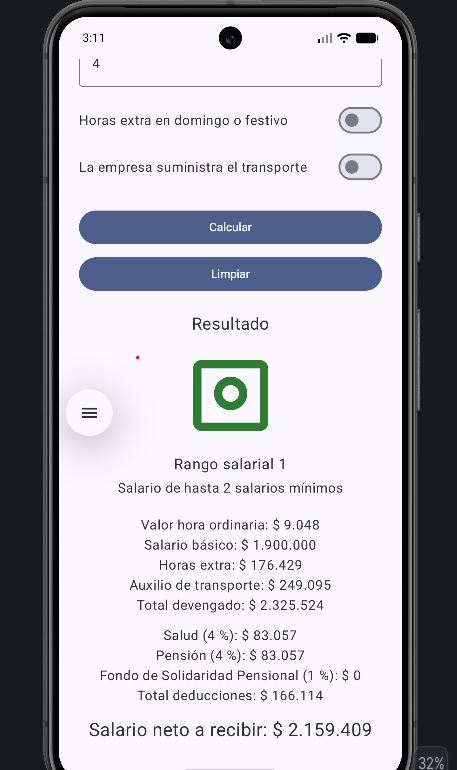
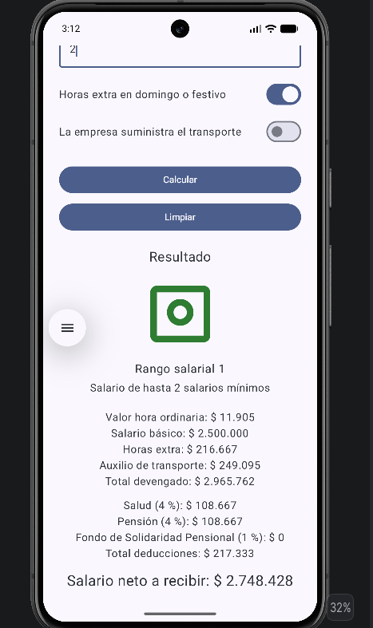
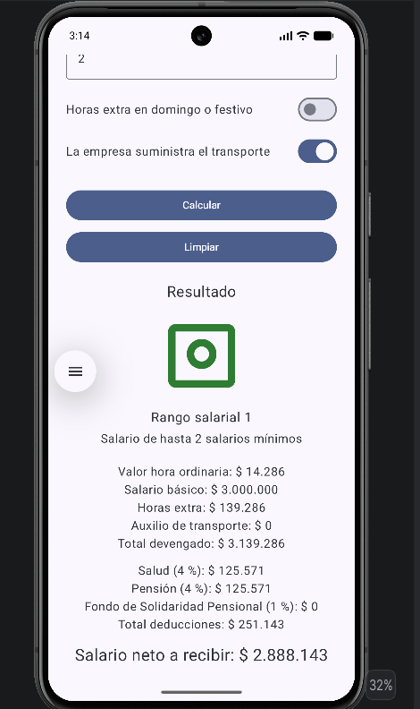
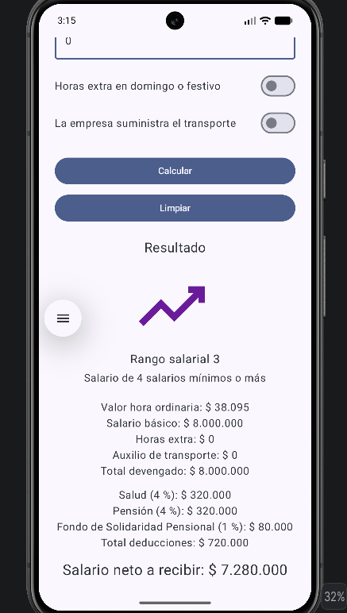
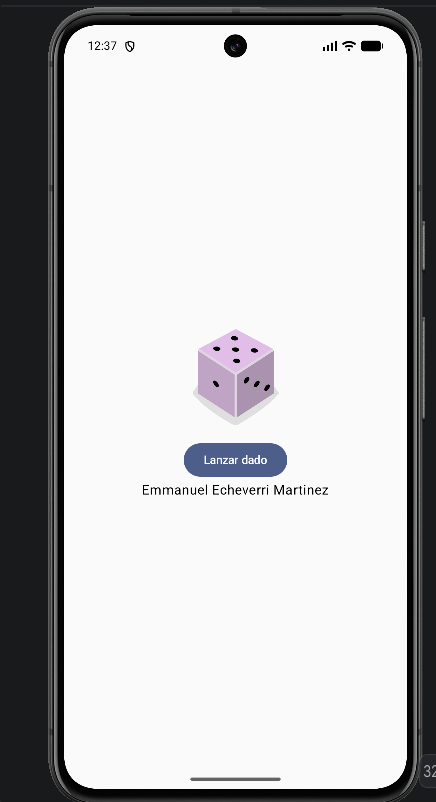
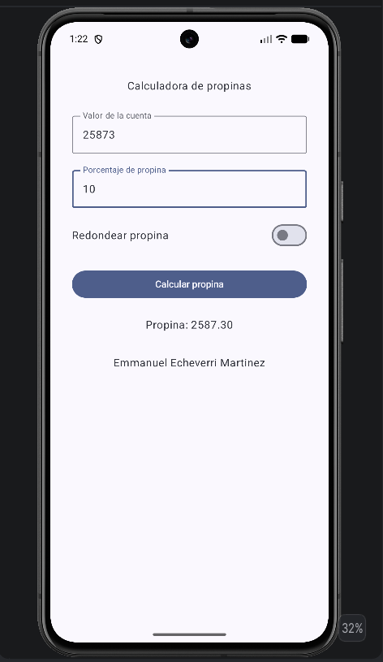

# Calculadora de Nómina

## Información del estudiante

**Nombre:** Emmanuel Echeverri Martinez  
**Código:** 52721

## Descripción

Aplicación Android desarrollada en Kotlin y Jetpack Compose para calcular una nómina mensual a partir del salario básico y las horas extra trabajadas.

La aplicación permite ingresar el salario básico mensual, las horas extra diurnas y nocturnas, indicar si las horas extra corresponden a domingo o festivo y seleccionar si la empresa suministra el transporte.

La aplicación realiza el cálculo de la nómina y presenta el desglose de los valores devengados, las deducciones y el salario neto a recibir.

---

## Funcionalidades

La aplicación implementa las siguientes funcionalidades:

- Ingreso del salario básico mensual.
- Ingreso de horas extra diurnas.
- Ingreso de horas extra nocturnas.
- Selección de horas extra en domingo o festivo.
- Selección de transporte suministrado por la empresa.
- Cálculo del valor de la hora ordinaria.
- Cálculo de horas extra.
- Cálculo del auxilio de transporte.
- Cálculo del total devengado.
- Cálculo de aportes a salud.
- Cálculo de aportes a pensión.
- Cálculo del Fondo de Solidaridad Pensional.
- Cálculo del total de deducciones.
- Cálculo del salario neto.
- Clasificación del salario en tres rangos salariales.
- Visualización de una imagen correspondiente al rango salarial.
- Validación del salario mínimo.
- Validación de horas extra negativas.
- Validación del máximo de 48 horas extra mensuales.
- Botón para calcular la nómina.
- Botón para limpiar los campos y resultados.
- Recálculo automático cuando se modifica cualquiera de los interruptores después de haber realizado un cálculo.
- Interfaz desplazable verticalmente.
- Vista previa mediante `@Preview`.

---

## Tecnologías utilizadas

- Kotlin
- Android
- Jetpack Compose
- Material 3
- Android Studio

---

## Requisitos

Para ejecutar el proyecto se necesita:

- Android Studio.
- JDK compatible con la versión de Android Studio utilizada.
- Android SDK.
- Un dispositivo Android o un emulador configurado.

---

## Cómo ejecutar el proyecto

1. Clonar o descargar este repositorio.
2. Abrir la carpeta del proyecto en Android Studio.
3. Esperar a que Gradle termine de sincronizar.
4. Seleccionar un dispositivo físico o un emulador.
5. Ejecutar la aplicación utilizando el botón **Run** de Android Studio.

---

## Estructura principal del proyecto

```text
CalculadoraNomina/
│
├── app/
│   └── src/
│       └── main/
│           ├── java/
│           │   └── com/
│           │       └── emmanuelecheverri/
│           │           └── calculadoranomina/
│           │               ├── MainActivity.kt
│           │               ├── NominaCalculator.kt
│           │               └── ui/
│           │                   └── theme/
│           │
│           └── res/
│               ├── drawable/
│               └── values/
│                   └── strings.xml
│
├── evidencias/
├── gradle/
├── README.md
├── build.gradle.kts
├── settings.gradle.kts
├── gradlew
└── gradlew.bat
```

---

## Separación de responsabilidades

La interfaz de usuario se encuentra principalmente en:

```text
app/src/main/java/com/emmanuelecheverri/calculadoranomina/MainActivity.kt
```

La lógica de cálculo de la nómina se encuentra separada en:

```text
app/src/main/java/com/emmanuelecheverri/calculadoranomina/NominaCalculator.kt
```

Los textos utilizados por la interfaz se encuentran en:

```text
app/src/main/res/values/strings.xml
```

Las imágenes utilizadas para representar los rangos salariales se encuentran en:

```text
app/src/main/res/drawable/
```

---

## Validaciones

La aplicación valida los datos ingresados antes de realizar el cálculo.

### Salario obligatorio

Si el salario básico está vacío, se muestra un mensaje indicando que el salario es obligatorio.

### Salario mínimo

Si el salario ingresado es inferior al salario mínimo utilizado por la aplicación, se muestra un mensaje de validación y no se realiza el cálculo.

### Horas negativas

Las horas extra diurnas y nocturnas no pueden ser negativas.

### Máximo de horas extra

La suma de las horas extra diurnas y nocturnas no puede superar las 48 horas mensuales.

### Campos de horas vacíos

Si las horas extra diurnas o nocturnas se dejan vacías, se consideran como cero.

---

## Casos de prueba

Los casos de prueba se realizaron de acuerdo con los escenarios definidos para la aplicación.

### Caso A

```text
Salario básico:         1.750.905
Horas extra diurnas:   10
Horas extra nocturnas: 4
Domingo/festivo:       OFF
Transporte empresa:    OFF
```

Resultado esperado:

- Cálculo de la nómina.
- Clasificación correspondiente al primer rango salarial.
- Visualización del desglose de devengados y deducciones.

### Caso B

```text
Salario básico:         2.500.000
Horas extra diurnas:   6
Horas extra nocturnas: 2
Domingo/festivo:       ON
Transporte empresa:    OFF
```

Resultado esperado:

- Cálculo de la nómina.
- Aplicación del recargo correspondiente.
- Actualización del resultado al modificar el interruptor.

### Caso C

```text
Salario básico:         3.000.000
Horas extra diurnas:   5
Horas extra nocturnas: 0
Domingo/festivo:       OFF
Transporte empresa:    ON
```

Resultado esperado:

- Cálculo de la nómina.
- Aplicación de las condiciones correspondientes al transporte.
- Actualización del resultado.

### Caso D

```text
Salario básico:         8.000.000
Horas extra diurnas:   0
Horas extra nocturnas: 0
Domingo/festivo:       OFF
Transporte empresa:    OFF
```

Resultado esperado:

- Clasificación correspondiente al tercer rango salarial.
- Cálculo del Fondo de Solidaridad Pensional.
- Presentación del salario neto.

### Caso E — Validaciones

Se probaron entradas inválidas y casos límite, incluyendo:

- Salario vacío.
- Salario inferior al mínimo.
- Horas extra negativas.
- Más de 48 horas extra mensuales.
- Campos de horas vacíos.
- Repetición del cálculo con datos inválidos sin cierre inesperado de la aplicación.

---

## Evidencias

### Caso A



### Caso B



### Caso C



### Caso D



### Caso E - Validación


### Dice Roller



### Tip Time



### Calculadora de Nómina

```text
evidencias/
├── caso_A.png
├── caso_B.png
├── caso_C.png
├── caso_D.png
└── validacion_E.png
```

Las imágenes anteriores corresponden a los casos de prueba A, B, C, D y E.

### Codelab Dice Roller

```text
evidencias/
└── DiceRoller.png
```

La evidencia corresponde al desarrollo del codelab Dice Roller y contiene la identificación del estudiante.

### Codelab Tip Time

```text
evidencias/
└── TipTime.png
```

La evidencia corresponde al desarrollo del codelab Tip Time y contiene la identificación del estudiante.

---

## Codelabs

### Dice Roller
**Repositorio:**  
https://github.com/emmanuelecheverri/DiceRoller

### Tip Time
**Repositorio:**  
https://github.com/emmanuelecheverri/TipTime.git

---

## Autor

**Emmanuel Echeverri Martinez**  
**Código:** 52721